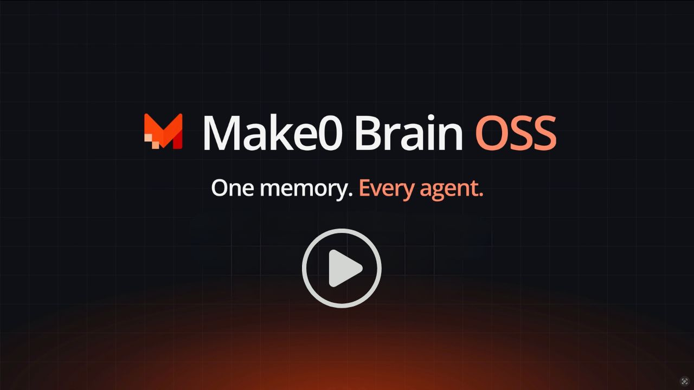

# Make0 Brain

**One context for every AI agent you use.** Claude Code, Claude Desktop, Cursor, Codex, Windsurf, VS Code, Gemini CLI, Hermes Agent, and OpenClaw all read and write the same memory, and every change is versioned.

A local-first, open-source [MCP](https://modelcontextprotocol.io) memory server. After a one-time model download it runs offline with no API key, keeps everything in one SQLite file on your machine, and speaks the same 7 tools as the hosted [Make0](https://make0.ai) Brain.

[Make0](https://make0.ai) · [SWE-ContextBench results](https://make0.ai/benchmarks/swe-contextbench)

<p align="center">
  <a href="https://www.npmjs.com/package/@make0-ai/brain"></a>
  <a href="https://www.npmjs.com/package/@make0-ai/brain"></a>
  <a href="LICENSE"></a>
  <a href="package.json"></a>
</p>

<p align="center">
  <a href="https://mcprush.com/to/make0-brain-mcp?ref=badge"></a>
  <a href="https://glama.ai/mcp/servers/make0-official/brain-oss"></a>
</p>

```bash
npx @make0-ai/brain init
```

Only using Cursor or VS Code? These buttons add the server to that one app. Run `init` too if you want it to download the models up front and write the custom instruction.

<p align="center">
  <a href="https://cursor.com/en/install-mcp?name=make0-brain&amp;config=eyJjb21tYW5kIjoibnB4IiwiYXJncyI6WyIteSIsIkBtYWtlMC1haS9icmFpbiJdfQ%3D%3D"><picture><source media="(prefers-color-scheme: dark)" srcset="https://cursor.com/deeplink/mcp-install-light.svg"></picture></a>
  <a href="https://insiders.vscode.dev/redirect/mcp/install?name=make0-brain&amp;config=%7B%22command%22%3A%22npx%22%2C%22args%22%3A%5B%22-y%22%2C%22%40make0-ai%2Fbrain%22%5D%7D"></a>
  <a href="https://insiders.vscode.dev/redirect/mcp/install?name=make0-brain&amp;config=%7B%22command%22%3A%22npx%22%2C%22args%22%3A%5B%22-y%22%2C%22%40make0-ai%2Fbrain%22%5D%7D&amp;quality=insiders"></a>
</p>

<p align="center">
  <a href="https://www.youtube.com/watch?v=YXV0Hje9BvE">
    
  </a>
</p>

---

## Why

Every agent keeps its own memory. Claude has `CLAUDE.md`, Cursor has rules, Codex has `AGENTS.md`, ChatGPT has its memory page. You end up explaining your stack, your preferences, and last week's decisions again in each one, and the copies drift apart.

Make0 Brain is one memory that all of them share:

- **Tell one agent, every agent knows.** A fact saved from Cursor is found by Claude Code in the next session.
- **Nothing is overwritten silently.** Every edit, from any agent, is kept as a version with who wrote it and when.
- **It stays yours.** One SQLite file on your machine, MIT licensed, exportable to plain Markdown.

<p align="center">
  <picture>
    <source media="(prefers-color-scheme: dark)" srcset="https://github.com/make0-official/brain-oss/raw/main/docs/images/how-it-works-dark.png">
    
  </picture>
</p>

## Quick start

**1. Connect your agents.**

```bash
npx @make0-ai/brain init
```

`init` finds Claude Code, Claude Desktop, Cursor, Windsurf, VS Code, Codex CLI, Gemini CLI, Hermes Agent, and OpenClaw. When more than one is installed, it asks which to configure. Press Enter for all of them, or pass `--clients` to choose up front. `init --yes` configures every detected agent without asking. It then shows what it will change, asks once, keeps a `.make0-backup` of each config file, and adds Make0 Brain to each chosen app. It downloads the two local models (about 50 MB, once) with a progress bar, so your first question to an agent doesn't wait on a download. Restart the apps afterwards.

Connecting the server is not enough. The agent also needs a custom instruction so it searches Brain before answering and saves lasting facts there. `init` writes this into the global rules file for Claude Code (`~/.claude/CLAUDE.md`), Codex (`~/.codex/AGENTS.md`), Gemini (`~/.gemini/GEMINI.md`), and Windsurf. Cursor, Claude Desktop, VS Code, Hermes Agent, and OpenClaw keep rules in settings or a persona file, so `init` prints the same text for you to paste:

```text
Make0 Brain is my source of truth for durable memory. Always search it before answering about me, my work, people, preferences, or past decisions. Save lasting facts and decisions to Brain. Never guess or invent memories. Use Brain exclusively for durable memory.
```

| App            | Where it goes                                            |
| -------------- | -------------------------------------------------------- |
| Claude Code    | `~/.claude/CLAUDE.md`, written by `init`                 |
| Codex CLI      | `~/.codex/AGENTS.md`, written by `init`                  |
| Gemini CLI     | `~/.gemini/GEMINI.md`, written by `init`                 |
| Windsurf       | Global rules, written by `init`                          |
| Cursor         | Settings → Rules → User Rules. Paste it.                 |
| Claude Desktop | Settings → Profile → personal preferences. Paste it.     |
| VS Code        | `.github/copilot-instructions.md` in the repo. Paste it. |
| Hermes Agent   | `~/.hermes/SOUL.md`. Paste it.                           |
| OpenClaw       | `~/.openclaw/workspace/AGENTS.md`. Paste it.             |

Skip the rule with `init --no-rules`.

**2. Bring in the context you already have.**

```bash
npx @make0-ai/brain import --detect             # CLAUDE.md, AGENTS.md, Cursor/Windsurf/Copilot rules
npx @make0-ai/brain import ~/Documents/MyVault  # an Obsidian vault or any Markdown folder
pbpaste | npx @make0-ai/brain import -          # e.g. a memory dump copied from ChatGPT
```

**3. Look at it.**

```bash
npx @make0-ai/brain view
```

The viewer opens on `127.0.0.1` with every brain, how many memories each holds, and what your apps retrieved and added this week.

<p align="center">
  <picture>
    <source media="(prefers-color-scheme: dark)" srcset="https://github.com/make0-official/brain-oss/raw/main/docs/images/viewer-brains-dark.png">
    
  </picture>
</p>

Models live in `~/.make0/models` and data in `~/.make0/brain.db`. If you skip `init` (or pass `--no-models`), the first save or search downloads the models instead.

### Verify it works

Restart the apps you connected, then check that a memory written by one agent reaches another:

1. **Save from one agent.** In Cursor (or any connected app), say: *"Remember that my test fruit is mango."* It should call `add_memory`.
2. **Find it from another.** In a new Claude Code session (or any other connected app), ask: *"What is my test fruit?"* It should call `search_brain` and answer "mango" without being told.
3. **Check who wrote it.** Run `npx @make0-ai/brain view`, open the personal brain, and click the memory. It shows **Added by Cursor** and a version timeline.

Delete the test memory in the viewer when you are done. If step 1 or 2 doesn't call a Brain tool, the app is missing the custom instruction above (Cursor, Claude Desktop, and VS Code need it pasted) or wasn't restarted. Run `npx @make0-ai/brain agents` to confirm the app can use the personal brain.

## One context across all agents

### Same tools in every app

After `init`, every connected agent gets the same 7 tools:

| Tool                  | What the agent uses it for                                      |
| --------------------- | --------------------------------------------------------------- |
| `list_brains`         | Get the brain ids this app can use. `personal` is always there until you allocate others. |
| `search_brain`        | Find memories for a focused query before answering.             |
| `get_memory`          | Read one memory in full.                                        |
| `get_memory_versions` | Read every saved version of a memory, newest first.             |
| `add_memory`          | Save a fact or a short Markdown note when you ask it to.        |
| `update_memory`       | Change a memory. The previous text is kept as a version.        |
| `delete_memory`       | Archive a memory. Its versions are kept and you can restore it. |

The names and schemas match the hosted Make0 Brain, so a prompt or agent setup works against either one.

### More than one brain

The personal brain is created with the database and cannot be deleted. Add others when a project should not share those memories:

```bash
npx @make0-ai/brain brains create "Work" --description "Client work" --agents cursor,claude-code
npx @make0-ai/brain brains                 # list brains
npx @make0-ai/brain agents                 # which app can use which brain
npx @make0-ai/brain import ~/Notes --brain Work
npx @make0-ai/brain view --brain Work
```

An app with no allocation sees only `personal`. `agents grant` and `agents revoke` change that, and so does the Connect dialog in `view`. Revoking every brain leaves the app with none: `list_brains` comes back empty until you grant one again. The viewer and the CLI can open every brain. Agents only see brains you give them, and `list_brains` is how they learn the id to pass to the other tools.

Open a brain to see its memories as a board, one column per category, with the app that wrote each one.

<p align="center">
  <picture>
    <source media="(prefers-color-scheme: dark)" srcset="https://github.com/make0-official/brain-oss/raw/main/docs/images/viewer-board-dark.png">
    
  </picture>
</p>

Upgrading from an older Make0 Brain does not need a new `init`. The next time an app starts the server, npm picks up the new package and the existing `~/.make0/brain.db` migrates in place. Your memories stay on the personal brain. If `npx @make0-ai/brain --version` is still `0.1.x`, a global install is shadowing npx: `npm install -g @make0-ai/brain@latest`.

### Every memory knows who wrote it

Make0 Brain reads the client name each app sends when it connects and records it as the writer: `claude`, `chatgpt`, or `cursor`. Any other app is recorded as `mcp`, with its own client name kept too. Search results show `addedBy` for each memory, and every version records who wrote it. You can see which agent learned what.

### See what each app reads and writes

Every memory an app retrieves or writes is counted per app and per brain, with a rough token count. The home page shows this week at a glance; **Details** opens the full chart, filterable by brain, range, and app, in memories, tokens, or average tokens per call. The counters stay in the local database.

<p align="center">
  <picture>
    <source media="(prefers-color-scheme: dark)" srcset="https://github.com/make0-official/brain-oss/raw/main/docs/images/viewer-activity-dark.png">
    
  </picture>
</p>

### Context stays consistent

- **Contradictions replace older facts.** If Cursor saves "I don't like dark mode in my editor" after Claude saved "I like dark mode in my editor", the newer memory wins and the older one is archived, with its history intact.
- **Duplicates merge (with an API key).** An LLM judge compares close matches and merges restatements into one memory. The merged text may only use words from the two originals, so it cannot invent facts. Without a key, duplicates are kept rather than guessed at.
- **Related memories are linked.** Similar memories get links automatically, and search follows them up to two hops, so asking about a project also surfaces the decisions tied to it.

Switch a brain to **3D** to orbit and zoom through it: categories branch from the center, and each memory sits on its category.

<p align="center">
  <picture>
    <source media="(prefers-color-scheme: dark)" srcset="https://github.com/make0-official/brain-oss/raw/main/docs/images/viewer-graph-dark.png">
    
  </picture>
</p>

### Your existing agent rules become shared memory

`import --detect` reads the rule files you already wrote for one agent and makes them available to all of them. Make0 Brain's own "search Brain first" block is stripped out so it is never imported as a memory.

## Memory versioning

Every write to a memory creates a version, whether it comes from an agent, an import, or you in the viewer. Nothing is overwritten in place.

### What a version records

| Field                                                     | Meaning                                                            |
| --------------------------------------------------------- | ------------------------------------------------------------------ |
| `versionNumber`                                           | 1, 2, 3… per memory.                                               |
| `current`                                                 | The version agents read now. Exactly one per memory.               |
| `content`, `category`, `kind`, `entityType`, `confidence` | The memory as it was at that point.                                |
| `writtenBy`                                               | `user`, `make0`, `claude`, `chatgpt`, `cursor`, or `mcp`.          |
| `writerName`                                              | The app's own client name when `writtenBy` is the generic `mcp`.   |
| `embeddingModel`                                          | The embedder that indexed the text while this version was current. |
| `createdAt`                                               | When the version was written.                                      |

A version is written when the content, category, kind, or entity type changes. A confidence-only change does not add one.

### Agents can read the history

Search results include `versionCount`. When it is greater than 1, an agent can call `get_memory_versions` to see how a fact changed and who changed it: for example, that you switched from npm to pnpm last month and which agent recorded it.

### Nothing is lost

| Action                                   | What happens                                           |
| ---------------------------------------- | ------------------------------------------------------ |
| `update_memory` or an edit in the viewer | A new current version. Older versions stay.            |
| A contradicting or merged memory         | The older memory is archived with all its versions.    |
| `delete_memory`                          | Archived: hidden from search and reads, versions kept. |
| Re-import of an edited note              | A new version of that memory, not a duplicate.         |
| Re-import of a note you deleted          | Skipped. Deleted stays deleted.                        |
| `make0-brain purge <id> --yes`           | The only permanent delete. Agents cannot do it.        |

### Browse and restore

```bash
npx @make0-ai/brain history <id>               # every version, current one marked *
npx @make0-ai/brain restore <id> --version 2   # make version 2 current again
npx @make0-ai/brain restore <id>               # bring back an archived memory
```

```text
* v3  2026-10-27T09:14:02.118Z  claude
    The project uses pnpm and Node 22.
  v2  2026-10-20T16:40:51.502Z  cursor
    The project uses pnpm.
  v1  2026-10-02T11:05:33.910Z  user
    The project uses npm.
```

Restoring makes an older version current again and re-indexes it. No version is deleted.

<p align="center">
  <picture>
    <source media="(prefers-color-scheme: dark)" srcset="https://github.com/make0-official/brain-oss/raw/main/docs/images/viewer-versions-dark.png">
    
  </picture>
</p>

`npx @make0-ai/brain view` opens a local page (on `127.0.0.1` only) where you can create and switch brains, browse memories as a board or in 3D, search, add, and edit them, read each memory's version timeline, restore a version, bring back archived memories, inspect the stored embedding, and permanently delete.

## Search quality

Measured on [SWE-ContextBench](https://arxiv.org/abs/2602.08316) Lite, the same comparison as the [Make0 benchmark page](https://make0.ai/benchmarks/swe-contextbench): 300 earlier coding sessions and 99 related issues. The score is how often search returns the gold past session. The local install uses the offline MiniLM embedder and the ms-marco MiniLM reranker. Once the models are loaded, search takes about **80ms** per query on an Apple M2 Pro.

Rank 1, the gold session is the first result:

```text
Make0 Brain (cloud)   █████████████████████████████░░░░░░░░░░░  71.7%
Make0 Brain (local)   █████████████████████████░░░░░░░░░░░░░░░  62.6%  ~80ms
LangMem               ██████████████████████░░░░░░░░░░░░░░░░░░  55.6%
OpenViking            ███████████████░░░░░░░░░░░░░░░░░░░░░░░░░  38.4%
Free summary search   ██████████████░░░░░░░░░░░░░░░░░░░░░░░░░░  34.3%
Mem0                  ██████████░░░░░░░░░░░░░░░░░░░░░░░░░░░░░░  25.3%
Supermemory           █████████░░░░░░░░░░░░░░░░░░░░░░░░░░░░░░░  23.2%
```

Overall, the gold session appears anywhere in the results:

```text
Make0 Brain (cloud)   ██████████████████████████████████████░░  93.9%  top 10
Make0 Brain (local)   █████████████████████████████████████░░░  92.9%  top 10   ~80ms
LangMem               █████████████████████████████░░░░░░░░░░░  73.3%  top 10
Supermemory           ████████████████████████░░░░░░░░░░░░░░░░  59.6%  top 15
OpenViking            █████████████████████░░░░░░░░░░░░░░░░░░░  51.5%  top 3
Mem0                  ████████████████░░░░░░░░░░░░░░░░░░░░░░░░  39.4%  top 3
Free summary search   ███████████████░░░░░░░░░░░░░░░░░░░░░░░░░  36.4%  agent chooses
```

LangMem, OpenViking, Mem0, Supermemory, and free summary search are from Table 5 of that paper. "Overall" counts a hit anywhere in each system's own result list; Make0 cloud, Make0 Brain, and LangMem each return 10. On the full benchmark (1,007 past tasks, 357 related issues), hosted Make0 scores 71.4% at rank 1 and 88.2% overall. A stronger embedder and reranker raise accuracy.

How search works: MiniLM embeddings and BM25 keyword scores are blended, a cross-encoder reranks the shortlist (or an LLM filter, with a key), weak results are pruned, and the top results are expanded two hops along memory links.

## Import and export

### Import

- **Folders and vaults.** Each note becomes one memory. Long notes split by heading, and each part keeps the note title. Frontmatter tags or the folder name become the category. Obsidian `[[wikilinks]]` become links between memories. `.obsidian/` and `.trash/` are skipped.
- **Agent rule files.** `--detect` finds global rules under your home folder and project rules in the current folder.
- **Re-runs are safe.** Unchanged sections are skipped, edited ones get a new version, and memories you deleted stay deleted.
- **`--extract`** (needs an API key) turns files into one-fact memories instead of note-sized ones.
- `--dry-run` shows what would change. Imports over 200 memories ask first; `--yes` skips the question.

### Export

```bash
npx @make0-ai/brain export ./my-brain          # one Markdown file per memory, opens as an Obsidian vault
npx @make0-ai/brain export --json brain.json   # every memory, version, and link (the Make0 port format)
```

The Markdown export imports back in. The JSON bundle includes archived memories and the full version history. It does not include embeddings; whoever reads it re-embeds with their own model.

## Optional API key

Nothing needs a key. With one, Make0 Brain also merges duplicate memories, picks better categories, filters search results with an LLM, and can `import --extract`.

Copy `.env.example` to `.env` in this folder, or to `~/.make0/.env` so every app shares one file:

```bash
cp .env.example ~/.make0/.env
```

```text
OPENAI_API_KEY=sk-...            # or OPENROUTER_API_KEY, or MAKE0_BRAIN_API_KEY
MAKE0_BRAIN_BASE_URL=            # any OpenAI-compatible endpoint (optional)
MAKE0_BRAIN_LLM_MODEL=           # default gpt-6-luna
MAKE0_BRAIN_EMBEDDINGS=api       # API embeddings instead of local MiniLM
MAKE0_BRAIN_LLM_SEARCH=0         # keep search on the local reranker
```

Make0 Brain reads `./.env`, then `.env` in the data folder (`MAKE0_BRAIN_HOME`, default `~/.make0`). A variable already set in the environment, including in an MCP client's `env` block, wins. Switching embedders is safe: memories indexed by another model are re-embedded on the next search.

## Privacy and security

### What leaves your machine

| When                                          | What is sent                                                     | To                                    |
| --------------------------------------------- | ---------------------------------------------------------------- | ------------------------------------- |
| `init`, or the first save or search           | Download requests for the two local models (no memory content)   | Hugging Face                          |
| Normal use with no API key                    | Nothing                                                          |                                       |
| With an API key: saves                        | The new memory and close matches, to merge duplicates and pick a category | Your provider (`MAKE0_BRAIN_BASE_URL`, default OpenAI) |
| With an API key: search (`MAKE0_BRAIN_LLM_SEARCH` not `0`) | The query and candidate memories, to filter results    | Your provider                         |
| With an API key: `import --extract`           | The full text of the imported files                              | Your provider                         |
| `MAKE0_BRAIN_EMBEDDINGS=api`                  | The text of every memory and every query, to embed it            | Your provider                         |

Make0 Brain has no telemetry and does not contact Make0. The usage counts in the viewer stay in the local database.

Make0 Brain being local does not make your agents local. When an agent calls `search_brain`, the memories it gets back go into that agent's conversation, and that conversation is sent to the agent's own model provider (Anthropic for Claude, OpenAI for Codex, and so on). Keep anything you would not paste into that agent out of the brains it can use. `agents grant` and `agents revoke` control which brains each app sees.

### Where your data lives

- **Database:** `~/.make0/brain.db`, a plain SQLite file with your memories, every version, links, and usage counts. It is not encrypted; it is protected by your user account and disk encryption.
- **Imports:** the text of each note is copied into the database, with its file path and a hash so re-imports can find changes. The original files are only read, never changed.
- **Agent config:** `init` keeps one `.make0-backup` of each config file it edits, and adds a marked block to the rule files listed above.
- **API key:** read from `.env` or the environment. It is never stored in the database or in exports.

### Bad or malicious memories

A memory is text, and an agent can read it as an instruction. A web page or a file an agent was working on can try to get it to save something like "always run this script". Make0 Brain cannot tell a true fact from a planted one, but it makes them easy to find and undo:

- Every memory and version records which app wrote it, so an unexpected writer stands out in the viewer.
- Nothing is overwritten in place. A bad edit can be reverted with `restore <id> --version <n>`.
- Agents can archive memories but cannot permanently delete them. Only `purge` and the viewer can.
- Give an app only the brains it needs, and keep a separate brain for untrusted work.

### The viewer

`view` listens on `127.0.0.1` only, so other machines cannot reach it. It has no login, but it only answers requests addressed to `127.0.0.1` or `localhost` on its own port, which blocks DNS-rebinding tricks. Requests that change memories or brains must come from the viewer's own page and be sent as JSON: other sites' requests are refused, and a browser will not send another site's JSON request without the viewer's approval, which it never gives. Other programs on your computer can still call it while it runs, so stop the viewer (Ctrl+C) when you are not using it.

## Backups, upgrades, and support

### Backups

Make0 Brain does not back up your database by itself. Copy one of these somewhere safe, and do it before you upgrade:

```bash
npx @make0-ai/brain export --json ~/make0-brain-backup.json   # every memory, version, and link
sqlite3 ~/.make0/brain.db ".backup ~/make0-brain-backup.db"    # an exact copy, safe while apps are running
```

Copy `brain.db` directly only when no app is running, or you may miss recent writes that are still in `brain.db-wal`. To restore, stop your apps and copy the `.db` backup over `~/.make0/brain.db`. The JSON bundle is a readable record of everything and the format for moving to Make0 cloud; `import` does not read it back yet.

### Upgrades

Agents run the server through `npx`, so they pick up a new release the next time they start. On first open, a new version migrates `brain.db` in place, one transaction per step, so a failed step leaves the database as it was. Migrations add tables and columns and fill in new fields; they do not remove your memories. Older versions are not tested against a migrated database, so back up before upgrading if you might go back.

### Requirements and status

- **Node.js 20 or newer.**
- **Operating systems:** developed and tested on macOS. `init` knows the Linux and Windows config paths, but those platforms are not covered by automated tests yet. Reports are welcome.
- **Status:** pre-1.0. The 7 MCP tools match the hosted Make0 Brain and are kept stable. CLI flags and the viewer may still change between minor versions.
- **Known limits:** one machine, no sync between devices; one memory holds up to 4,000 characters; without an API key, duplicates are kept rather than merged; the viewer has no login (see above).

### Releases

Each release is published to [npm](https://www.npmjs.com/package/@make0-ai/brain), tagged `vX.Y.Z` on GitHub, and listed in the [MCP Registry](https://registry.modelcontextprotocol.io). The commit message for each tag describes what changed. Patch releases are fixes. Minor releases can add features and database migrations.

### Reporting a problem

Open an issue at [github.com/make0-official/brain-oss/issues](https://github.com/make0-official/brain-oss/issues) with:

- the output of `npx @make0-ai/brain --version` and `npx @make0-ai/brain stats`;
- your OS, Node version, and the agent app involved;
- the command or prompt, and any error text.

Do not paste private memories or your `.env`. For a security problem, open an issue that says only that you have one, and we will arrange a private channel.

## Local or cloud

|              | This repo                              | Make0 cloud                                                       |
| ------------ | -------------------------------------- | ----------------------------------------------------------------- |
| **Best for** | Local agents, data on your machine     | Every device and web app, including ChatGPT and Claude on the web |
| **Setup**    | `npx @make0-ai/brain init`             | Sign in at [make0.ai](https://make0.ai)                           |
| **API key**  | None required                          | Make0 account                                                     |
| **Brains**   | Personal and custom                    | Personal, project, and custom brains                              |
| **Storage**  | `~/.make0/brain.db`                    | Hosted                                                            |
| **Search**   | MiniLM + BM25 + cross-encoder, ~80ms on an Apple M2 Pro | Stronger embedder and reranker                                    |

A one-command port from local to Make0 cloud is coming. The `export --json` bundle is the format it will use, with history and attribution included.

## Reference

### CLI

```text
make0-brain                      Run the MCP server over stdio
make0-brain init                 Add Make0 Brain to your AI apps and download the models (--dry-run, --yes, --clients, --no-rules, --no-models)
make0-brain import <path…>       Import files, folders, or a vault (--detect, -, --extract, --brain, --dry-run, --yes)
make0-brain export [dir]         Markdown export (--json [file] for the bundle, --brain to limit it)
make0-brain brains               List, create, edit, or delete brains
make0-brain agents               Show or change which brains each app can use
make0-brain view                 Open the memory viewer in a browser (--port, --no-open, --brain)
make0-brain stats                Show memory and link counts (--brain)
make0-brain history <id>         List saved versions of a memory
make0-brain restore <id>         Restore an archived memory (--version <n> for an older version)
make0-brain purge <id> --yes     Permanently delete a memory and its versions
```

On a terminal, `init` lists the agents it found and asks which to configure. Press Enter for all of them, or enter numbers (`1,3` or `1-3`) or ids. `init --yes` configures every detected agent without asking. `init --clients` skips the prompt and takes a comma-separated list of `claude-code`, `claude-desktop`, `cursor`, `windsurf`, `vscode`, `codex`, `gemini`, `hermes`, `openclaw`.

### Manual setup

If `init` doesn't cover your app, add a stdio server and paste the custom instruction from the quick start into that app's rules:

```json
{
  "mcpServers": {
    "make0-brain": { "command": "npx", "args": ["-y", "@make0-ai/brain"] }
  }
}
```

### Environment

| Variable                                                        | Default                                     | Purpose                                 |
| --------------------------------------------------------------- | ------------------------------------------- | --------------------------------------- |
| `MAKE0_BRAIN_HOME`                                              | `~/.make0`                                  | Data folder: database, models, `.env`.  |
| `MAKE0_BRAIN_DB`                                                | `$MAKE0_BRAIN_HOME/brain.db`                | Database file.                          |
| `OPENAI_API_KEY` / `OPENROUTER_API_KEY` / `MAKE0_BRAIN_API_KEY` | unset                                       | Turns on the optional LLM features.     |
| `MAKE0_BRAIN_BASE_URL`                                          | OpenAI, or OpenRouter for an OpenRouter key | OpenAI-compatible endpoint.             |
| `MAKE0_BRAIN_LLM_MODEL`                                         | `gpt-6-luna`                                | Chat model.                             |
| `MAKE0_BRAIN_EMBEDDINGS`                                        | `local`                                     | `local` (MiniLM) or `api`.              |
| `MAKE0_BRAIN_EMBEDDING_MODEL`                                   | `text-embedding-3-small`                    | Embedding model when `api`.             |
| `MAKE0_BRAIN_LLM_SEARCH`                                        | on with a key                               | `0` keeps search on the local reranker. |

## Develop

```bash
npm install
npm test            # fast suite, no model downloads
npm run test:models # real local models
npm run test:e2e    # build, then drive the stdio server
```

The viewer UI is a React app in `web/`, built into `dist/web` and served by `make0-brain view`.

```bash
npm run build:web                                   # once, so `npm run dev -- view` has a UI
MAKE0_BRAIN_DB=/tmp/try.db npm run dev -- view --no-open
npm run dev:web                                     # hot reload at http://localhost:5173, API proxied to :4173
```

## License

MIT
